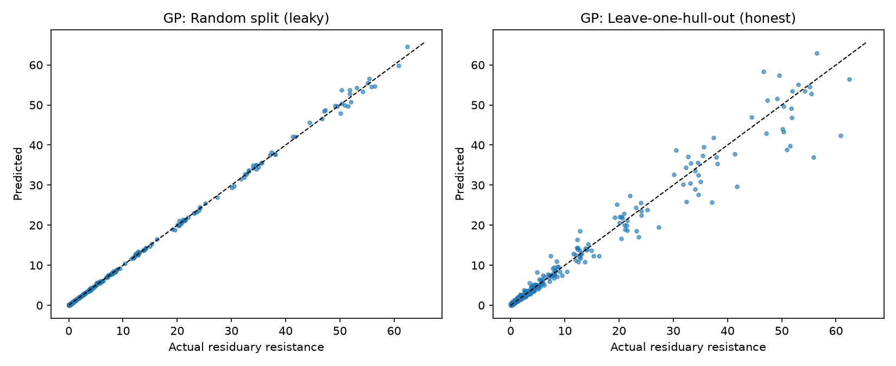
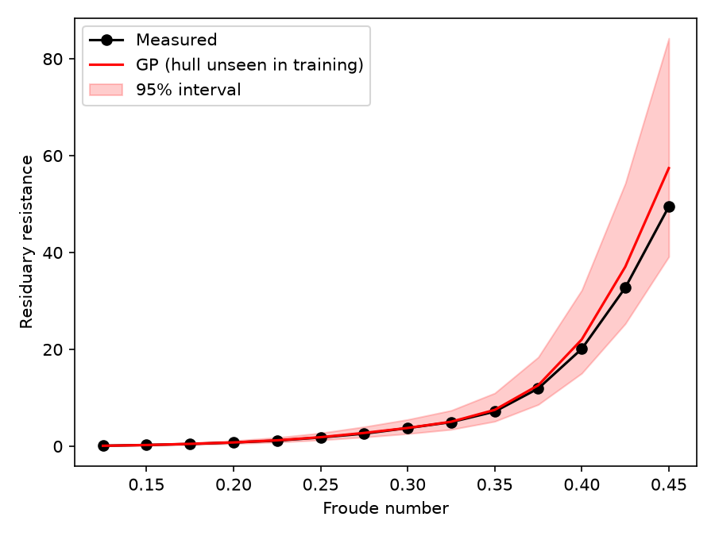

# Surrogate Modelling of Ship Residuary Resistance

Fast machine-learning surrogates for predicting the residuary resistance of sailing-yacht hulls, evaluated on **hull forms the models have never seen**, as design optimisation requires.

A personal project exploring surrogate modelling and physics-constrained neural networks for ship design and hydrodynamics.

## Motivation

CFD and tank tests are slow and expensive. A trained surrogate can approximate resistance in milliseconds, making automated design exploration practical. The key question is not "how accurate is the model on data like its training set?" but **"does it generalise to a new hull design?"**

## Dataset

Delft Systematic Yacht Hull Series (Gerritsma et al., 1981), from the [UCI Machine Learning Repository](https://archive.ics.uci.edu/dataset/243/yacht+hydrodynamics).

- 308 samples: 22 distinct hull forms, each tested at 14 speeds
- **Inputs (6):** longitudinal position of the centre of buoyancy, prismatic coefficient, length-displacement ratio, beam-draught ratio, length-beam ratio, Froude number
- **Target:** residuary resistance per unit weight of displacement

## Evaluation design

Because each hull appears at 14 speeds, a random train/test split leaks hull geometry into the test set. This project compares:

1. **Random 10-fold CV** (3 repeats, averaged), which is leaky by design
2. **Leave-one-hull-out CV** (22 folds), in which each hull is held out entirely and the model must predict a design it has never seen

## Methods

- **Features:** 5 hull-form parameters, Froude number, plus Froude-number powers and log (wave-making resistance rises steeply with speed)
- **Target:** log(resistance), predictions transformed back to the original scale
- **Models:**
  - Polynomial ridge regression (degree 2 and 3)
  - Gradient boosting (HistGradientBoosting), with and without a monotonic-in-Froude-number constraint
  - Gaussian process with ARD Matern kernel (gives uncertainty estimates)
  - PyTorch MLP, 5-member ensemble, with an optional autograd-based penalty on negative d(log R)/d(Fn), applied at training points and at sampled collocation points (the same mechanism physics-informed networks use for PDE residuals, applied here to a monotonicity constraint)

## Results

Errors are in the units of the dataset target. Unseen-hull results use leave-one-hull-out CV.

| Model | RMSE, random k-fold | RMSE, unseen hulls | MAE, unseen hulls | R², unseen hulls |
|---|---|---|---|---|
| Polynomial ridge (deg 2) | 2.28 | 5.32 | 2.17 | 0.877 |
| Polynomial ridge (deg 3) | 3.26 | 6800 | 731 | not meaningful (unstable) |
| Gradient boosting | 3.14 | 1.01 | 0.48 | 0.996 |
| Gradient boosting (monotonic in Fn) | 3.10 | **0.99** | **0.46** | 0.996 |
| Gaussian process (ARD) | **0.40** | 2.83 | 1.31 | 0.965 |
| MLP ensemble (no constraint) | n/a | 1.99 | 0.97 | 0.983 |
| MLP ensemble (monotonicity penalty) | n/a | 1.99 | 0.97 | 0.983 |

### Findings

- **Random splits are misleading for some models.** The Gaussian process looks nearly perfect on a random split (R² 0.999) but its error is about 7x higher on unseen hulls (RMSE 2.83). Evaluating on unseen hulls changes which model looks best.
- **Gradient boosting generalised best to new hulls** (R² 0.996, RMSE ~1.0). It did *not* show the degradation seen with the GP and polynomial models. In fact its error was lower on unseen hulls than on the random split. I did not establish why.
- **The cubic polynomial is numerically unstable on unseen hulls.** It extrapolates wildly in log space, and exponentiating amplifies the error. The degree-2 model is a more reasonable baseline.
- **The monotonicity constraint did not help measurably.** For gradient boosting it was better on 15 of 22 hulls, but the median difference was tiny (Wilcoxon p = 0.545). For the MLP, the penalty gave no change (RMSE 1.992 vs 1.995). One possibility is that the data already follow the monotonic trend, so the constraint is rarely active; I did not verify this.
- **Uncertainty calibration varies.** The GP's 95% intervals covered 90.3% of unseen-hull points (slightly overconfident). The MLP ensemble's intervals covered only about 51%, because seed-to-seed spread understates true uncertainty.




## Repository structure

```
ship_resistance_surrogate.py   # data loading, features, classical models, GP, CV, plots
pinn_style_mlp.py              # PyTorch MLP ensemble with monotonicity penalty
results.csv                    # classical-model CV results
pred_vs_actual.png
resistance_curve_unseen_hull.png
```

## Reproduce

```bash
pip install numpy pandas scikit-learn scipy matplotlib torch
python ship_resistance_surrogate.py --data yacht_hydrodynamics.data
python pinn_style_mlp.py --data yacht_hydrodynamics.data
```

## Limitations

- Only 22 hull forms in a narrow parameter range (small yacht hulls, residuary resistance only). Results show methodology, not a validated design tool.
- The monotonicity constraint assumes resistance does not decrease with Froude number over the tested range.
- MLP hyperparameters were not tuned, and the MLP was not evaluated under the repeated random-split protocol.
- The unexplained gradient boosting behaviour (better on unseen hulls than on random splits) is an open question.

## Possible extensions

CFD-generated training data (e.g. OpenFOAM), multi-fidelity modelling combining cheap and expensive data, better-calibrated uncertainty (e.g. deep ensembles with bootstrapping), and total resistance and propulsion prediction.

## References

- Gerritsma, J., Onnink, R. and Versluis, A. (1981). Geometry, resistance and stability of the Delft systematic yacht hull series.
- Dataset: UCI Machine Learning Repository, Yacht Hydrodynamics.
